# hitl — Human In The Loop

**hitl** is where an AI agent and its human meet. The agent **asks** you questions, **shows** you things, asks you to
**review** its work, and waits at a **gate** for your OK. You answer, review, mark up pictures and browse the project's
files, on your phone or your computer. Everything you say lands in one feed the agent reads a little at a time.

The npm package is **`hitloop`**; once installed (`npm i -g hitloop`) the command is `hitl`.

```sh
npx hitloop init     # once per project: the .hitl folder, the MCP server for Claude Code, a note in CLAUDE.md
npx hitloop          # the page, for every project, with links for your phone
```

**Site: https://clickermonkey.github.io/hitloop/** (the commands, and a Claude skill to copy or download).

| | | | |
|:-:|:-:|:-:|:-:|
| 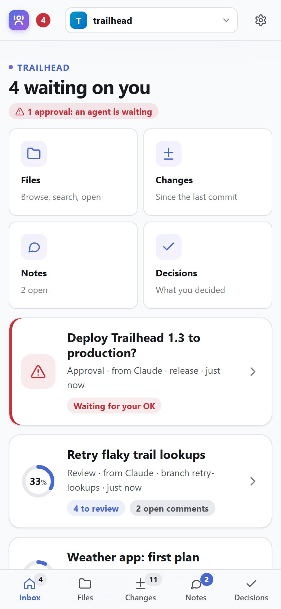 |  | 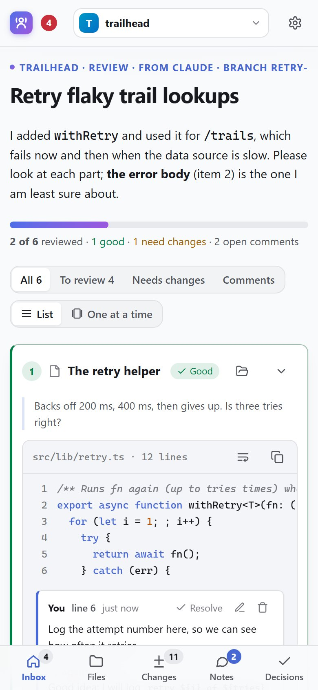 | 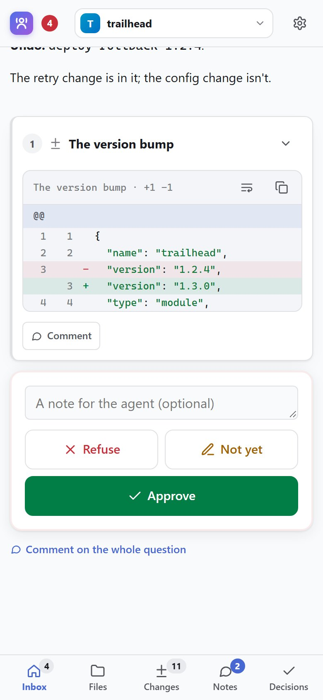 |
| **Inbox** | **Review** | **Before / after** | **Approve** |

"Human in the loop" means a person stays part of what an automated system does: it checks with them, they decide,
and it carries on. hitl gives that person somewhere to do it, instead of a chat scrolling past.

## What you can do

| | |
|---|---|
| **Inbox** | Everything waiting on you across every project, most urgent first: approvals (an agent is waiting), blocking questions, reviews, things to look at. What's done folds away. Changed your mind? **Dismiss** takes a request off the list (the agent sees it closed and stops waiting for it); **Reopen** brings it back. |
| **Answer questions** | Dozens at a time, with recommendations, why each one matters, and pictures, diffs and mockups to decide from. Take the recommendations and change the few you disagree with. Text answers grow and wrap as you type. |
| **Review** | Each thing the agent shows you gets **Looks good**, **Needs changes** or **No**. Comment on a line (tap its number; tap another for a range), on selected text, or on an **area of a picture** you draw around. Attach photos. Finish with **Approve** or **Request changes**. |
| **Comment on a selection** | Select any text — in a review item, a question, a file, a note — and tap **Comment**. The comment lands on that thing (the item and its lines, the question's thread, a note on the file and its lines, a reply on the note), or on the whole review or question set when the text is outside any one of them. It shows the text you selected and where it came from, and the agent reads both. |
| **One at a time** | Swipe through a review: right for looks good, left for needs changes. Good for thirty screenshots. |
| **Before and after** | Pictures with a slider (or side by side); code and text as after, before, and the changes between them. |
| **Approve** | An agent asks "Deploy 2.4.0 to production?" and waits. You get a notification, read what it will do, and tap **Approve** or **Refuse**. |
| **Browse the files** | Highlighted code, rendered markdown with Mermaid and math, images, CSV, JSON, notebooks, git status, diffs and history, search, downloads. Big files and big folders open quickly. |
| **Notes for the agent** | Write on any file, line or picture area, or about anything, with photos from your phone. The agent picks them up and resolves each with a reply. |
| **Messages from the agent** | The agent tells you something (done, stuck, a heads-up), on a file, on lines or about nothing in particular. Your phone gets it; reply on the thread and the agent reads your reply. |
| **Decisions** | Everything you answered, approved or gave a verdict on, searchable. Agents check it before asking again. |
| **Who's asking** | Each request says which agent session or branch made it. |
| **Notifications** | Your phone or computer buzzes when an agent asks, shows or waits, when a Claude Code session finishes, or when this computer crosses a line you set (Web Push, straight from the hub; https for phones built in). Approvals go out at once. |

It works on phones (sections along the bottom, big touch targets, the page scrolls), tablets and desktops (the file
tree, the folder and the file side by side).

## For agents

`npx hitloop init` adds the MCP server to Claude Code (`claude mcp add --scope user hitl -- npx -y hitloop@latest mcp`) and
a short section to the project's `CLAUDE.md` (or `AGENTS.md`) on when to use it.

### MCP tools

| Tool | |
|---|---|
| `news` | Everything the human said since you last read, across every question set, review and note, one line each. Start here. |
| `wait` | Block until the human says something (`any`), finishes (`done`), answers everything (`all`), or answers the blocking questions. Up to 15 minutes; for longer, run `npx hitloop wait` in the background. |
| `show` | Put files, code, text, diffs, pictures, diagrams, mockups or links in front of the human. `mode: "review"` asks a verdict per item; `"show"` is just to look. Each call makes its own review. |
| `approve` | Ask yes or no before doing something, and wait for it. Returns APPROVED, REFUSED or "not yet" with their note. |
| `add_questions` | Questions in a set: options, a recommendation, why it matters, follow-ups that open on an answer. |
| `get_feedback`, `get_answers`, `notes` | One review's feedback, one set's answers, the notes. |
| `send_message` | Tell the human something (done, stuck, a heads-up), on a file, on lines or about nothing in particular. It notifies their phone; their replies come back in `news`. |
| `ack`, `resolve`, `reply` | Mark answers and verdicts as dealt with, resolve comments and notes saying what you did, write back. |
| `decisions` | What the human decided before. |
| `status`, `get_link` | What's open; the links to send. |
| `update_item`, `remove_items`, `update_review`, `update_question`, `remove_questions`, `update_set`, `update_section`, `show_set` | Change things. |

### The CLI does the same

```sh
npx hitloop news                                  # what's new (marks it read; --peek doesn't)
npx hitloop wait --any                            # exit once the human says something, printing it
npx hitloop wait --done <review>                  # exit once they've finished a review (or answered an approval)
npx hitloop show src/login.ts screens/*.png --title "Login, round 2"     # a review of files
git diff | npx hitloop show - --title "The change"                      # stdin: a diff, code or text
npx hitloop approve "Deploy 2.4.0?" --details "Restarts the API" --timeout 30m && ./deploy.sh
npx hitloop ask <set> --file questions.json       # questions (or write .hitl/questions/<set>.json)
npx hitloop feedback <review>    npx hitloop answers <set> --new    npx hitloop notes --open
npx hitloop ack <set|review> <id…> --note "Done in src/x.ts"
npx hitloop resolve [<review>] <id…> --note "Fixed: …"
npx hitloop reply <review> c12 "Because the API bills per call."
npx hitloop message "Done: login works, try it" --path src/login.ts --lines 10-20
npx hitloop decisions auth                        # what was decided about auth
npx hitloop status                                # every request, with counts
```

`hitl approve` exits 0 when approved, 1 when refused (or changes are asked for), 2 when there's no answer yet, so a
script can stop at a real yes or no.

`npx hitloop --help` lists every command and option; a mistyped option is refused rather than ignored.

### Claude Code hooks (optional)

Off unless you turn them on, per project (`hitl hooks on`, `hitl hooks on --stop`, or Settings on the page):

- **News**: whenever you send Claude a message, it's told if you've said something in hitl it hasn't read.
- **Stop**: Claude can't finish while an approval or a blocking question is waiting, or while there's news it
  hasn't read. (It only holds Claude once, so it can't loop.)

## Where things live

```
<project>/.hitl/
  questions/<id>.json     question sets                        the agent writes
  reviews/<id>.json       reviews, showings and approvals      the agent writes
  answers/<id>.json, .md  what you said about each one         hitl writes
  notes/notes.json, NOTES.md, images/, photos/                 hitl writes
  media/                  pictures passed as data, snapshots of shown files, marked-up pictures, photos
  config.json             optional: exclude, hide, showSecrets, maxFileMb, git, watch for this project
```

Every request is its own file, and a new review always gets a fresh id, so one agent's request never replaces
another's. Every write is locked and atomic, so the page, the MCP server and the CLI can all write at once.
Formats: `npx hitloop schema questions`, `npx hitloop schema reviews` (or `schema/` in the package).

### A review

```json
{
  "title": "Login screen, round 2",
  "intro": "I moved the button and fixed the spacing. **The error text** is the part I'm least sure of.",
  "mode": "review",
  "from": "Claude · branch login-v2",
  "items": [
    { "file": "src/login.tsx", "note": "The form", "ask": "Is the error text clear?" },
    { "file": "src/api.ts", "against": "main", "title": "What changed in the API" },
    { "image": "screens/login.png", "before": "screens/login-old.png" },
    { "code": "{ \"retries\": 3 }", "before": "{}", "lang": "json", "name": "config.json" },
    { "diff": "--- a/x\n+++ b/x\n@@ …" },
    { "md": "## Left out\n- Password reset" },
    { "mermaid": "flowchart LR\n A --> B" },
    { "html": "<button>Sign in</button>", "height": 120 },
    { "link": "https://example.com/preview" }
  ]
}
```

A `file` item keeps a copy of the file as it was shown; if it changes later, the page says so and shows what changed.

## One server for every project

`npx hitloop` starts one shared server (the hub) on port 4199 for every project you've used it in, so your phone needs
one bookmark. The MCP server starts it in the background when an agent needs a link.

```sh
npx hitloop                       # the hub (adds this folder); prints the links
npx hitloop url [review|set]      # the links (starts the hub if needed)
npx hitloop stop                  # stop the hub
npx hitloop projects              # what it serves;  --forget <folder> to drop one
npx hitloop --solo [folder]       # just this folder, on its own server
```

| Option | Environment | Default | |
|---|---|---|---|
| `-p, --port <n>` | `HITL_PORT` | `4199` | The port to try first; the next free one is used. |
| `-H, --host <addr>` | `HITL_HOST` | `0.0.0.0` | Where to listen. The default lets your phone reach it. |
| `--base <path>` | `HITL_BASE` | `/` | Serve under a URL path (behind a proxy). |
| `--local` | | | Only this computer (`127.0.0.1`), no token. |
| `--token <t>` | `HITL_TOKEN` | made once | Open a link with `?token=…` once on each device; it's kept as a cookie. |
| `--no-token` | | | Anyone on your network can open it. |
| `--allow-host <h>` | | | Accept this host name too (a tunnel's). |
| `-x, --exclude <globs>` | | | Never show, serve, search or zip these. Also `.hitlignore` in a project. |
| `--hide <names>`, `--show-secrets`, `--max-file-mb <n>`, `--no-git`, `--no-watch`, `--author <name>` | | | File browsing. |
| `-o, --open` | | | Open it in your browser. |
| `--read-only` | | | Look, don't answer. |

Settings can also go in `~/.config/hitl/config.json` (`port`, `host`, `base`, `token`, `allowHosts`, `https`, `notify`,
`exclude`, `hide`, `showSecrets`, `maxFileMb`, `git`, `watch`). `HITL_HOME` moves that folder.

The links include every address your phone might use: your Wi-Fi or LAN address, and a Tailscale address if you have
one. Add the page to your phone's home screen and it opens like an app.

## Notifications

Tap the bell at the top (`#/notify`) and **Turn on notifications**. They come straight from the hub to the browser
(Web Push), encrypted so only that device can read them. Nothing to install, no account.

- **On this computer** it works at once: `http://localhost:4199` counts as a secure page.
- **On a phone** a browser only offers notifications on https pages. Tick **Answer https on this port too** (or run
  `npx hitloop https on`): the hub then answers http and https on the same port, with a certificate from its own
  certificate authority. The phone installs that authority once (the page walks you through it for Android, iPhone and
  other computers, and checks whether the phone trusts it yet), then opens the `https://` address and turns
  notifications on. On an iPhone or iPad, add the page to the home screen first (iOS 16.4 or later). The authority is
  made on this computer and never leaves it, and it can only vouch for local addresses (localhost, 10.x, 172.16–31.x,
  192.168.x, 100.64–127.x, this computer's name), never for another website.

**Slack**: paste an incoming webhook (in Slack: Apps → Incoming Webhooks → Add to Slack, pick a channel) on the
Notifications page or run `npx hitloop notify slack <url>`. Each notification posts to that channel with a button that
opens hitl. Only `hooks.slack.com` addresses are accepted, and the page shows the address masked.

Pick what notifies:

| Event | On at first |
| --- | --- |
| New questions; waiting for your OK (approvals); something to review; something to look at | yes |
| Messages from the agent; replies from the agent (on your answers, comments and notes) | yes |
| The agent acted on your answers (ack); resolved your notes; changed what it asked | no |
| A Claude Code session finished (worked for a while, now waits for you); a workflow finished (with the machine dashboard on) | no |
| Machine alerts | yes |

Questions and reviews are batched (one notification once the agent has been quiet for 20 seconds); approvals go out
within a couple of seconds. Notifications say what's waiting, never your answers.

**Machine alerts** (with the machine dashboard on): a notification when a reading stays past a line for a while (CPU,
memory, GPU use, temperature, memory and power, free disk space, disk and network speed, the CPU and memory of all
`claude` or `node` processes, Claude Code sessions open or working), or when a total over a window does (estimated
token cost, tokens, output tokens, tool calls, tool errors, model turns, prompts). For example "GPU temperature above
85 °C for 2 minutes" or "Token cost above $20 in 1 hour". Each rule then stays quiet for 30 minutes.

```sh
npx hitloop https on | off | status   # https on the hub's port too (no restart needed)
npx hitloop https trust               # trust the certificate on this computer (not needed for localhost)
npx hitloop https reset               # a new certificate authority (every phone installs it again)
npx hitloop notify                    # what's on, and the devices that get push
npx hitloop notify events [<event> on|off]
npx hitloop notify slack <url>        # also post each one to a Slack channel (an incoming webhook); slack off
npx hitloop notify webhook <url>      # also POST each notification as JSON: Pushover, Discord, Home Assistant, …
npx hitloop notify link <url>         # where a webhook's link should open
npx hitloop notify push on|off        # pause push for every device
npx hitloop notify test | off
```

## This computer (optional)

A dashboard of the computer the hub runs on, behind the monitor button in the bar (`#/machine`). It's **off until you
turn it on** (Settings, or `npx hitloop machine on`), and you can pause it for an hour, until the hub restarts, or until
you resume (`npx hitloop machine pause [1h|restart|resume]`, `resume`, `off`).

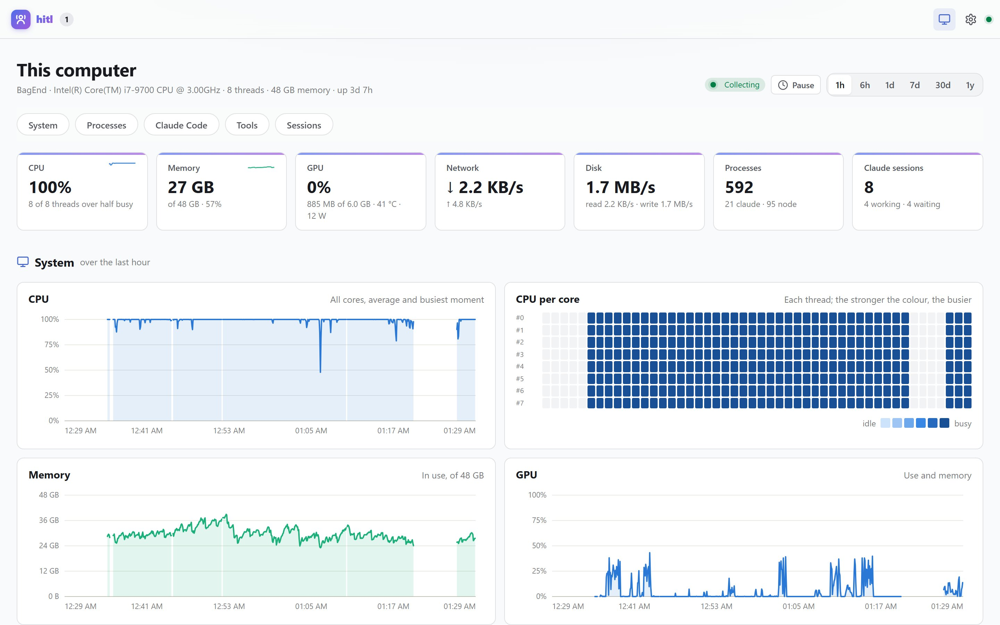

| 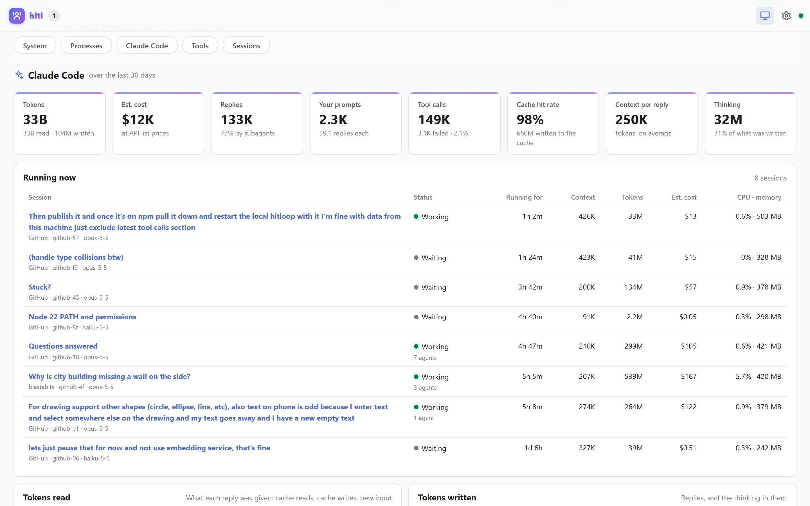 | 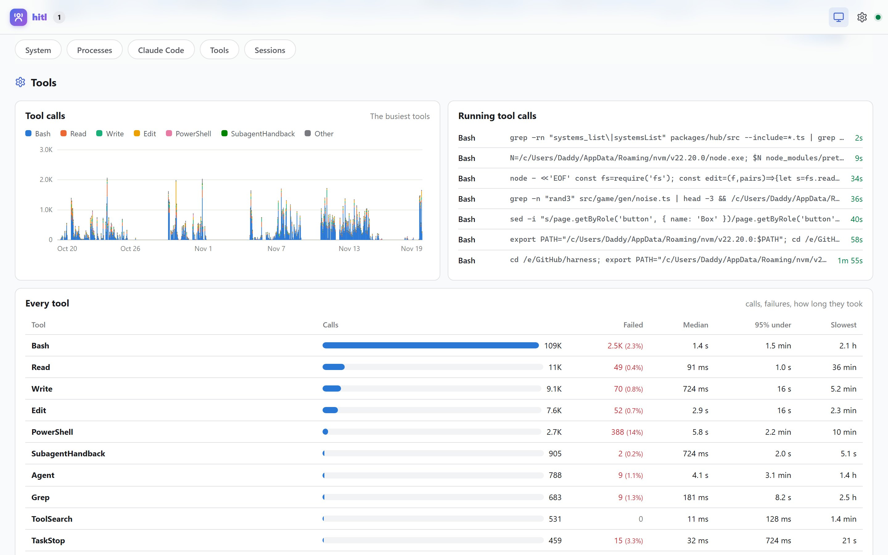 |
| --- | --- |
| 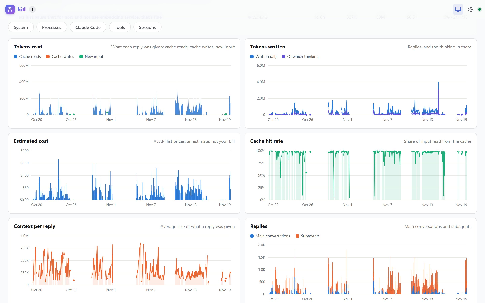 | 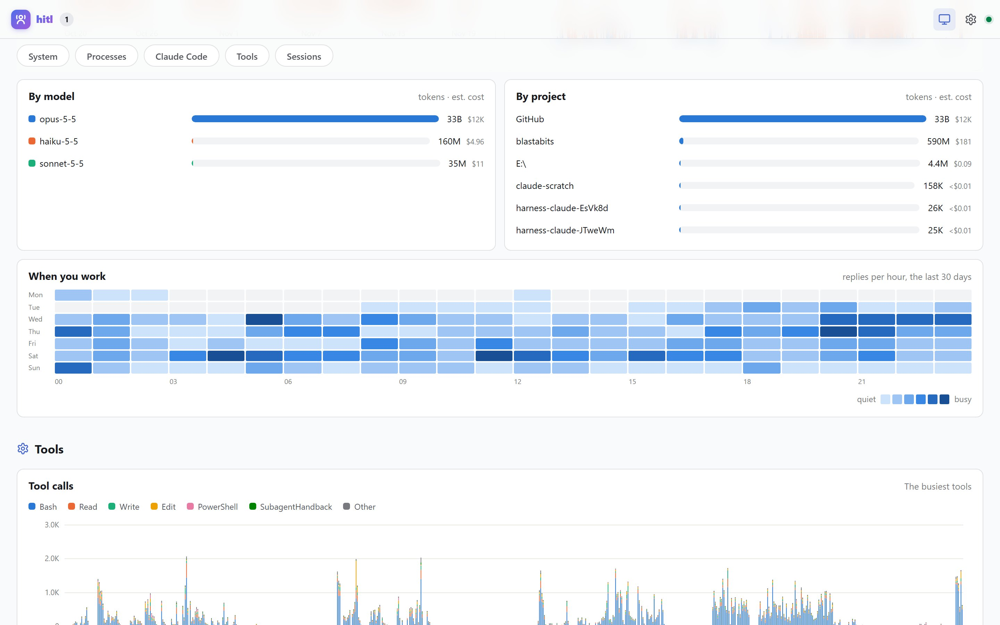 |
| 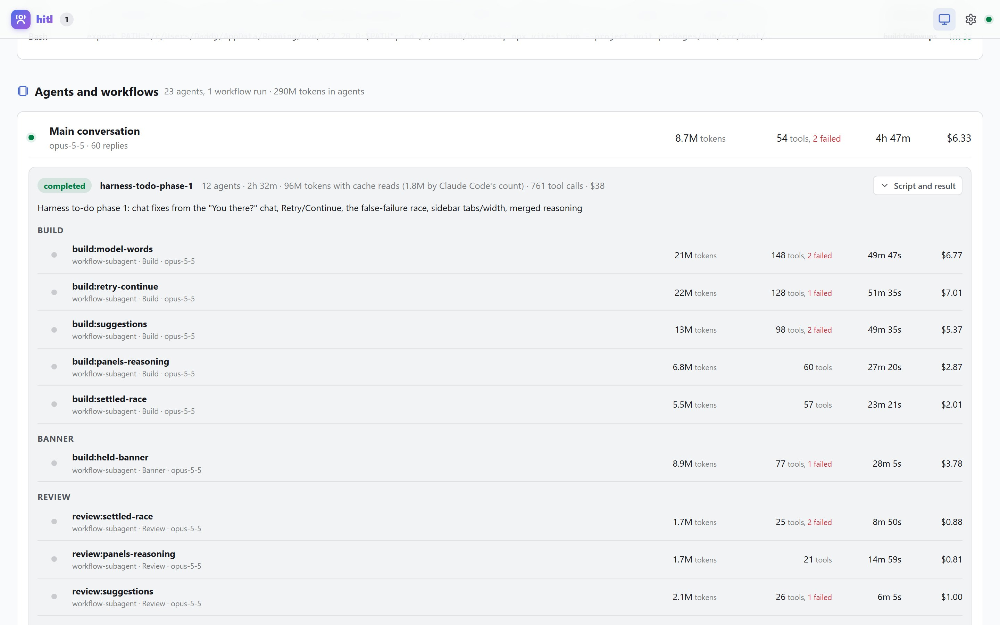 | 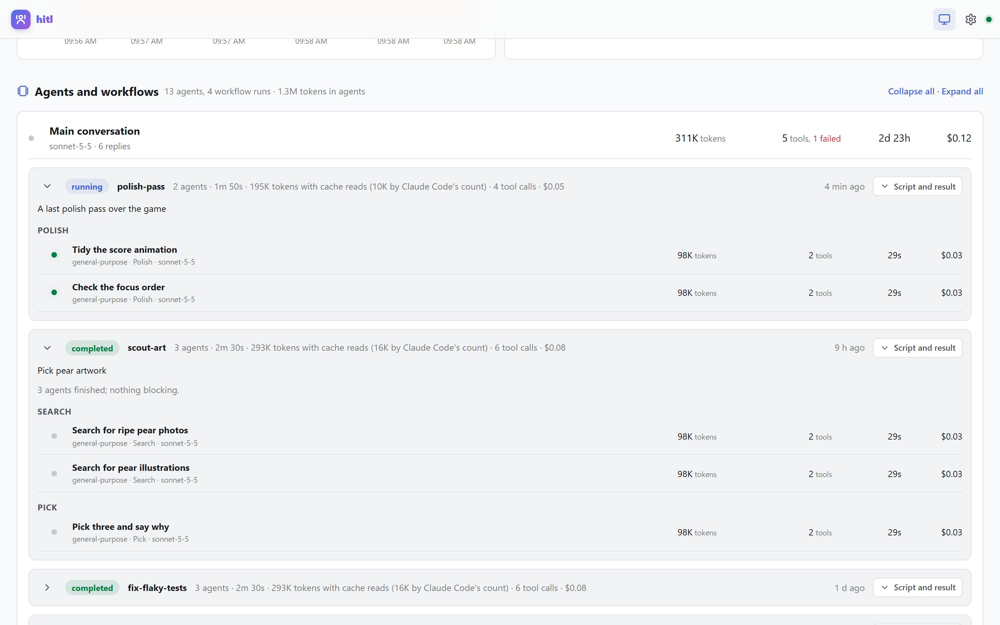 |
| 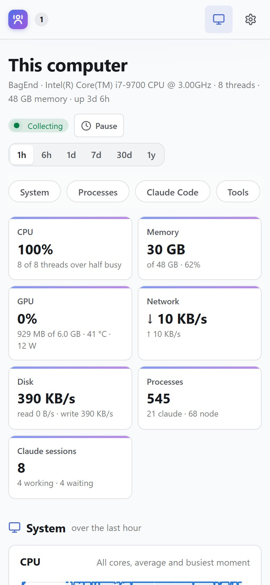 | |

### Workflows, agents and conversations

Claude Code hides most of what its subagents and workflows do. Open a session on the dashboard and every one of them is
there.

- **Fold a workflow** with its chevron or by clicking its header; "Collapse all" and "Expand all" do the lot. Finished
  workflows start folded, running ones open. What you fold or open is remembered in this browser (localStorage).
- **The newest first**: workflows and loose subagents are ordered by when they last did something, each with how long
  ago that was.
- **Click into any conversation**: "Main conversation" or any agent's name opens what was said. Messages (as
  markdown), the agent's thinking, every tool call with its input, its result and how long it took (failures in red),
  and **every picture it read**, loaded as you scroll to it and opened full size on a click. Tick or untick Thinking,
  Tool calls, Tool results and System notes (remembered too). Long conversations load 250 entries at a time.

| 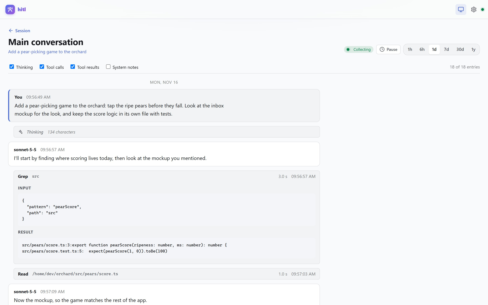 | 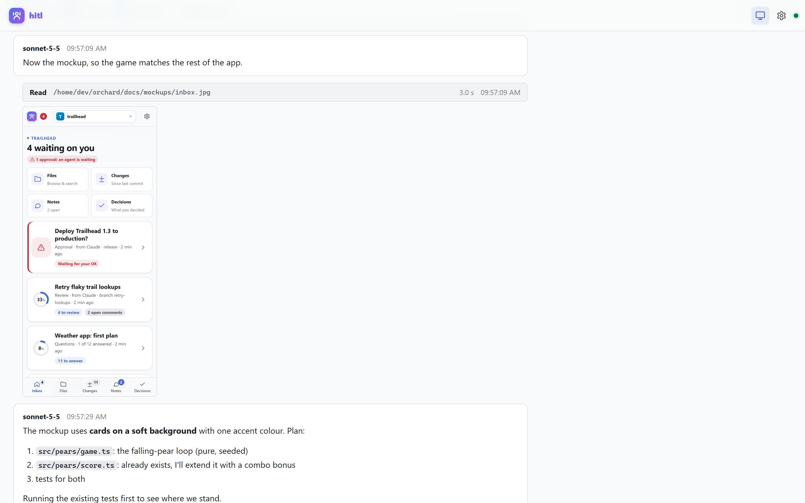 |
| --- | --- |
| 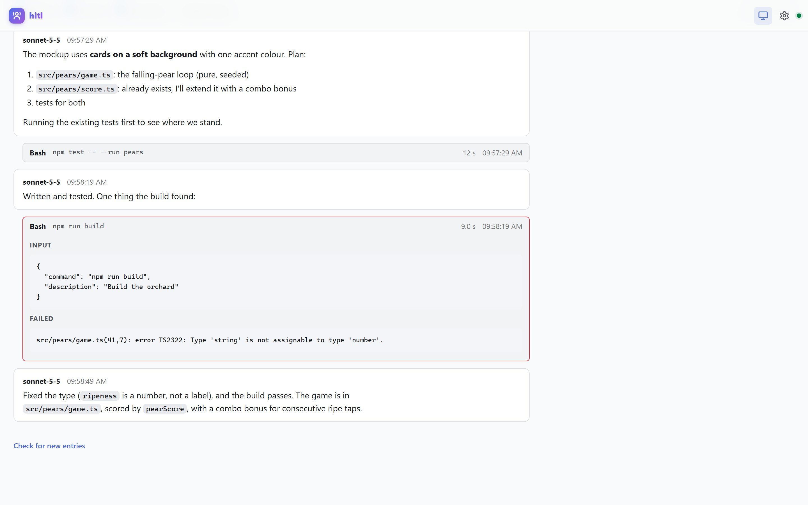 | 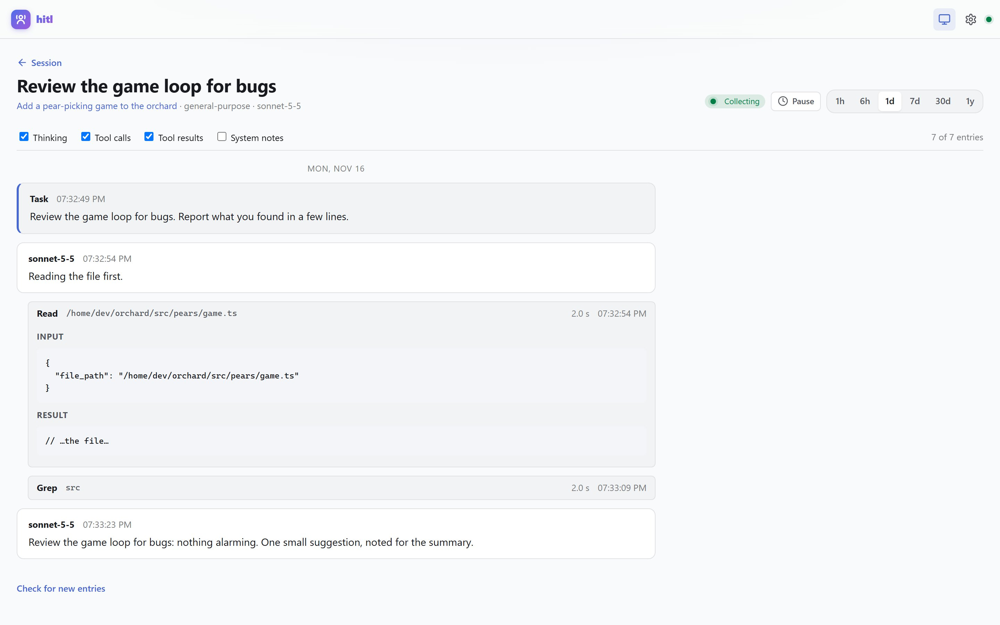 |

| 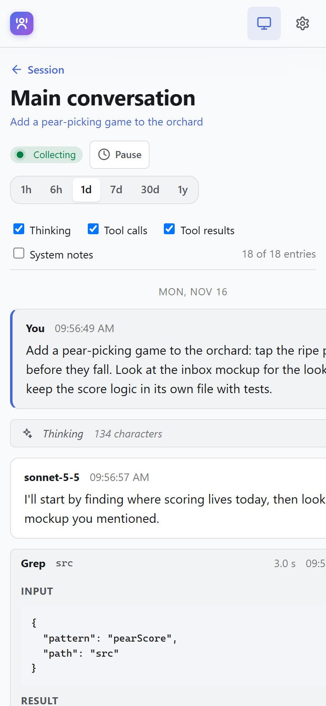 |
| --- |

These pictures come from a made-up Claude home (`node scripts/demo-claude.mjs`), so nothing real is in them; the
dashboard pictures above have the host name, session titles and project names swapped for made-up ones.

- **The computer**: CPU (all cores and each one), memory, GPU use, memory, heat and power (with `nvidia-smi`), network
  per adapter, disk activity, free space per drive, the busiest processes, and every `claude` and `node` process
  added up. Node's own numbers, plus `typeperf` and one PowerShell on Windows, `/proc` on Linux, `ps` on macOS.
- **Claude Code**, read from `~/.claude` (nothing is installed in your projects): the sessions running now (busy or
  waiting, context size, tokens, CPU and memory), tokens over time (cache reads and writes, new input, output,
  thinking) by model and by project, an estimated cost at API list prices, cache hit rate, context per reply, when you
  work (hour × weekday), every tool's calls, failures and how long they take, the tool calls running now, and each
  session's subagents and workflow runs (phases, agents, tokens, tool calls, the script and its result) and their
  full conversations.
- **Kept** in `~/.config/hitl/machine/` as round-robin files that never grow: 5-second detail for an hour, minutes for
  two days, 10 minutes for a month, hours for two years (about 100–200 KB per graph). The first time, it reads the
  last 30 days of transcripts in the background; after that only what's added.
- **Live** while the page is open: a sample every second (every 5 seconds otherwise).

## Safety

- **A token by default**: the server listens on your network so your phone can reach it, so every request needs the
  token (in the link once, then a cookie). `--local` listens on this computer only.
- **Project files** are served only from inside the project, never `.git` or secret-looking files (`.env`, `*.key`,
  `*.pem`, `id_rsa`), never through a link that points outside, and never excluded ones.
- **What an agent writes is untrusted**: markdown is sanitised, HTML runs in a sandbox with no scripts, SVGs and files
  are served so they can't run script, diagrams are drawn as images.
- **DNS rebinding** is refused (unknown host names), and so are writes from other sites.
- **The machine dashboard** is off unless you turn it on, reads only on this computer, and sends nothing anywhere.
- **It writes only** in `.hitl/` and its own config folder; `init` also writes `CLAUDE.md`, and the hooks
  `.claude/settings.json`.

## Development

```sh
npm install
npm test                                    # builds, then runs the tests
node scripts/demo.mjs .demo/trailhead       # a demo project with everything in it
HITL_HOME=.demo/home node dist/cli.js --solo .demo/trailhead --local
node scripts/shots.mjs http://localhost:4199/ .demo/shots   # phone and desktop screenshots of every page
npm run screens:machine -- http://localhost:4199/ <token>   # the README's machine dashboard pictures (names swapped for made-up ones)
node scripts/demo-claude.mjs .demo/claude   # a made-up Claude home: a session, workflows, a conversation with a picture
# then a hub on it (HITL_HOME=.demo/home CLAUDE_CONFIG_DIR=.demo/claude, machine on) and:
SHOTS=session,chat,agent npm run screens:machine -- http://localhost:4320/ '' 5d1c0a52-7be4-4d52-9a0b-3a6f8f0c2b11
```

- **The server** is TypeScript in `src/`, no runtime dependencies, Node 20 or newer.
- **The page** is plain JavaScript in `client/`, bundled by esbuild; Shiki's grammars, Mermaid and the math renderer
  load only when needed.

Releasing: bump the version in `package.json`, commit, push to main. The Release workflow publishes a version that
isn't on npm yet (trusted publishing), tags it and makes a GitHub release.

## License

MIT
